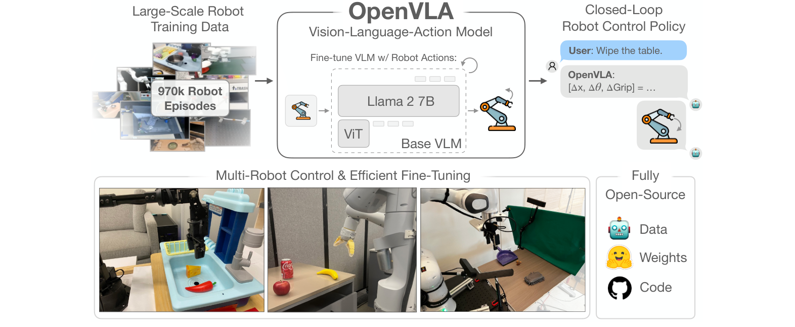
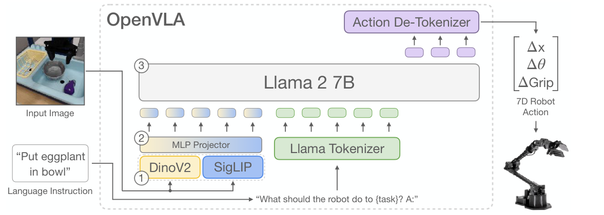
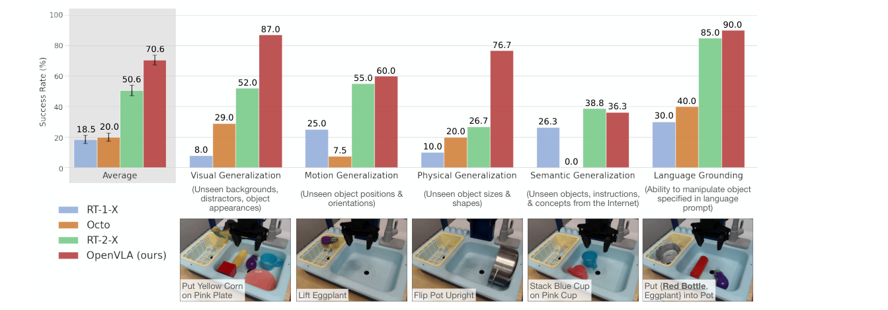
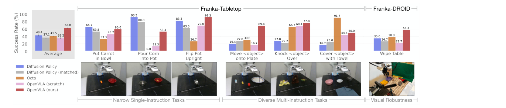

# OpenVLA：第一個開源、可微調的通用 VLA

| 速覽 | |
|---|---|
| **問題** | 既有 VLA（RT-2、RT-2-X）是閉源的，也沒人研究怎麼把 VLA 有效微調到新機器人 |
| **核心想法** | 沿用 RT-2「動作當文字 token」的做法，但換成開源的 Prismatic 7B（DINOv2 + SigLIP + Llama 2），在更大、更乾淨的 OpenX 資料上全參數微調 |
| **輸入 → 輸出** | 一張 224×224 第三人稱影像 + 語言指令 → 7 個動作 token → 7 維末端動作（Δ位置、Δ旋轉、夾爪） |
| **訓練** | Open X-Embodiment 篩選後 970k 條軌跡；只對動作 token 算 next-token cross-entropy |
| **關鍵證據** | BridgeData V2 17 項任務：70.6% vs RT-2-X（55B）50.6%（Fig. 3）；Google robot 85.0% vs 78.3%（Fig. 4） |

*圖：OpenVLA 用 970k 條機器人軌跡微調 VLM，輸出閉迴路控制動作，可直接控制多種機器人並有效微調，資料、權重、程式碼全部開源（論文 Figure 1）*

## 0. 問題：它要解決什麼？之前的方法缺了什麼？

### 任務設定

**語言條件的機器手臂操作**：輸入當下的相機影像和一句自然語言指令（例如「把茄子放進碗裡」），每一步輸出一個末端執行器的相對動作，閉迴路執行。

評估分兩種情境（§5）：

- **開箱即用（out-of-the-box）**：直接在訓練資料涵蓋的機器人上測泛化——WidowX（BridgeData V2，17 項任務 × 10 次）與 Google robot（12 項任務 × 5 次），測視覺、動作、物理、語意泛化與語言對應（language grounding）。
- **微調到新機器人**：Franka 手臂上的 7 項任務，每項只有 10–150 條示範。

### 之前方法的缺口

| 先前方法 / 路線 | 怎麼做 | 缺了什麼 |
|---|---|---|
| RT-2 / RT-2-X（55B） | 微調網路規模預訓練的 VLM（PaLI 系列），動作當 token 輸出 | **閉源**：架構、訓練流程、資料混合都看不到；沒有研究微調到新機器人；55B 參數難以部署 |
| Octo、RT-1-X（< 100M） | 從頭訓練的 transformer policy，拼接預訓練的語言 / 視覺元件 | 沒有網路規模的視覺語言預訓練，遇到干擾物、新物體、新指令就容易失敗 |
| Diffusion Policy | 針對單一任務從頭模仿學習 | 窄任務表現好，但多物體、多指令、需要語言對應的任務就不行 |
| 其他開源 VLA | 只在單一機器人或模擬環境訓練評估 | 缺乏通用性 |

缺口總結：社群需要一個**開源、夠強、而且能在一般 GPU 上微調**的通用 VLA。

## 1. 核心想法

**把機器人動作離散成 token，直接微調開源 VLM 去「說出」動作，並把資料、權重、程式碼全部開源。**

- VLM 已經在網路資料上學會「看圖、懂指令、找到對的物體」；把動作也變成語言模型詞彙中的 token，就能用標準的 next-token 訓練把這些能力轉成控制能力，不需要為機器人設計特殊架構。
- 相比 RT-2-X，OpenVLA 的提升來自三個工程選擇：**更多、更乾淨的資料**（970k vs 350k 條軌跡，並過濾掉全零動作）、**融合視覺編碼器**（DINOv2 的空間特徵 + SigLIP 的語意特徵），以及**連視覺編碼器一起微調**。
- 因為整個模型就是一個標準的 LLM，LoRA、量化等 LLM 生態系的工具可以直接拿來用。

自我檢驗：拿掉 OpenX 預訓練、只用 Bridge 資料，8 項 Bridge 任務的成功率從 76.3% 掉到 45.6%（Table 9）。

## 2. 資料流

*圖：OpenVLA 架構。(1) DINOv2 與 SigLIP 特徵串接的視覺編碼器；(2) MLP projector 把視覺特徵映射到語言 embedding 空間；(3) Llama 2 7B 輸出動作 token，再由 de-tokenizer 轉回連續動作（論文 Figure 2）*

- **輸入**：
  - 一張 224×224 的第三人稱相機影像（只有單張影像，沒有手腕相機、沒有本體感測、沒有歷史畫面）。
  - 語言指令，套進 prompt：`"What should the robot do to {task}? A:"`
- **輸出**：7 個動作 token → de-tokenize → 7 維相對末端動作 $[\Delta x, \Delta\theta, \Delta \text{Grip}]$（3 維位置變化、3 維旋轉變化、1 維夾爪）。

| # | 模組 | 輸入 → 輸出 | 作用 | 訓練狀態 |
|---|---|---|---|---|
| 1 | 視覺編碼器：DINOv2 + SigLIP（合計約 600M 參數） | 影像 patch → 兩組特徵，**沿 channel 串接** | DINOv2 提供低階空間資訊、SigLIP 提供高階語意 | 訓練（全參數微調） |
| 2 | MLP projector（2 層） | 視覺特徵 → 語言模型 embedding 空間的 visual tokens | 把影像變成 LLM 看得懂的 token | 訓練 |
| 3 | Llama tokenizer | prompt 文字 → text tokens | 編碼指令 | — |
| 4 | Llama 2 7B | [visual tokens; text tokens] → 自迴歸產生 7 個動作 token | 理解場景與指令並決定動作 | 訓練（全參數微調） |
| 5 | Action de-tokenizer | 7 個 token（各 256 bins 之一）→ 7 維連續動作 | 取該 bin 對應的連續值 | 不需訓練 |

**文字版骨架**：`影像 → [DINOv2 ‖ SigLIP] → MLP projector → visual tokens ┐ + 指令 → Llama tokenizer → text tokens → Llama 2 7B → 7 個動作 token → de-tokenizer → 7 維動作`

### 動作離散化（§3.2）

- 每個動作維度**各自**切成 256 個 bin，bin 的範圍取訓練資料中該維度的**第 1 到第 99 百分位數**（RT-2 用 min–max，容易被離群值拉大範圍、降低解析度）。
- Llama tokenizer 只保留 100 個 special token，不夠放 256 個動作 token，所以直接**覆寫詞彙表中最少用的最後 256 個 token** 當動作 token。

### 白紙檢驗

畫架構圖時一定要畫對的點：

1. DINOv2 和 SigLIP 是**同一張影像分別過兩個編碼器、特徵沿 channel 串接**，不是兩組 token 接在一起。
2. 動作是語言模型詞彙表裡的 token，用**自迴歸**一個維度一個維度地生成，每一步只輸出一個時間步的動作（沒有 action chunking）。
3. 每個動作維度各自離散成 256 bins（1%–99% 百分位數）。
4. 視覺編碼器、projector、LLM **全部一起微調**，沒有凍結。
5. 輸入只有一張第三人稱影像，沒有本體感測與歷史。

## 3. 怎麼訓練

### 資料

| 階段 | 資料集 | 規模 | 說明 |
|---|---|---|---|
| VLM 預訓練（沿用 Prismatic） | LLaVA 1.5 資料混合 | 約 1M 個影像–文字與純文字樣本 | SigLIP、DINOv2、Llama 2 本身的預訓練資料未公開（§3.1） |
| VLA 訓練 | Open X-Embodiment（OpenX）篩選 | 970k 條真實機器人軌跡 | 只留至少有一個第三人稱相機、單臂末端控制的操作資料；資料權重沿用 Octo（§3.3、Appendix A） |
| 微調到新機器人 | Franka-Tabletop、Franka-DROID | 每項任務 10–150 條示範 | 7 項任務（§5.2） |

資料混合中比例最高的是 Bridge 13.3%、Fractal 12.7%、Kuka 12.7%、BC-Z 7.5%、FMB 7.1%（Table 3）。DROID 以 10% 加入，但動作 token 準確率一直很低，訓練最後三分之一就拿掉了。另外過濾掉 Bridge 每條示範第一步的全零動作，避免模型學會「停住不動」（Appendix C）。

### Loss

論文以文字描述：只在**動作 token** 上計算標準的 next-token cross-entropy（§3.2）。依描述寫成：

$$
\mathcal{L}(\theta) = -\sum_{k=1}^{7} \log p_\theta\big(a_k \mid a_{<k},\, I,\, \ell\big)
$$

- 符號說明：$a_k \in \{0, \dots, 255\}$ 是第 $k$ 個動作維度的 bin 編號；$I$ 是影像；$\ell$ 是語言指令（prompt）；prompt 部分不算 loss。
- 白話：把「下一步該怎麼動」當成一個 7 個字的回答，訓練模型說出正確的字。

### 訓練細節

- 凍結 / 訓練：全部 7B 參數都訓練，**包含視覺編碼器**。凍結視覺編碼器的平均成功率是 46.7%，微調是 80.0%（Table 10）。
- 解析度：224×224。和 384×384 相比沒有表現差異，但後者訓練時間是 3 倍（§3.4）。
- Epoch：27 個 epoch，一直訓練到動作 token 準確率超過 95%（一般 LLM / VLM 只跑 1–2 個 epoch）。
- 學習率：固定 $2\times10^{-5}$，沒有 warm-up。
- 算力：64 張 A100 訓練 14 天，共 21,500 A100-hours，batch size 2048（§3.5）。
- 推論：bfloat16 需要 15GB GPU 記憶體，在 RTX 4090 上約 6Hz。
- 微調到新機器人：全參數微調用 8 張 A100、每項任務 5–15 小時；LoRA 只要 1 張 A100、10–15 小時（§5.3）。

## 4. 證據與位置

### 最關鍵的實驗

*圖：BridgeData V2 WidowX 上各泛化類別的成功率，共 170 次 rollout（論文 Figure 3）*

- **出處**：Figure 3、Table 4，§5.1。
- **設定**：WidowX 機器人 17 項任務 × 10 次，涵蓋視覺 / 動作 / 物理 / 語意泛化與語言對應；同一組初始狀態做 A/B 比較。對手是 RT-1-X（35M）、Octo（93M）、RT-2-X（55B，閉源）。
- **關鍵數字**：平均成功率 **70.6%**，RT-2-X 50.6%、Octo 20.0%、RT-1-X 18.5%。
  - 視覺泛化 87.0 vs 52.0、物理泛化 76.7 vs 26.7、語言對應 90.0 vs 85.0（OpenVLA vs RT-2-X）。
  - **語意泛化 RT-2-X 較好**：38.8 vs 36.3。RT-2-X 有和網路資料一起 co-fine-tune，保留較多網路知識。
  - Google robot（Fig. 4）：85.0% vs RT-2-X 78.3%，兩者相當。
- **為什麼最能支持主張**：論文的主張是「開源、小一個數量級的模型可以超越最強的閉源 VLA」。這個實驗正是在 RT-2-X 的主場（OpenX 涵蓋的機器人）、用最廣的泛化軸線直接比較，而 OpenVLA 只有 7B 參數。
- **Ablation**（Table 9，8 項 Bridge 任務）：

  | 模型 | 成功率 |
  |---|---|
  | OpenVLA（OpenX + DINOv2/SigLIP） | 76.3% |
  | OpenVLA-Bridge（只用 Bridge 資料） | 45.6% |
  | OpenVLA-Bridge-SigLIP（再拿掉 DINOv2） | 40.6% |

  OpenX 資料的影響（約 30 個百分點）遠大於 DINOv2（約 5 個百分點）。

**其他實驗重點**：

| 實驗 | 結果 | 出處 |
|---|---|---|
| 微調到 Franka（7 項任務、129 次） | 平均 63.8%，Diffusion Policy 43.4%、Octo 41.5%、沒有 OpenX 預訓練的 OpenVLA (scratch) 35.2%；唯一在所有任務都達到 50% 以上的方法 | Fig. 5、Table 7 |
| 參數高效微調 | LoRA（r=32）68.2%，只訓練 1.4% 參數，記憶體 59.7GB；全參數微調 69.7%、163.3GB；只訓最後一層 30.3%、凍結視覺 47.0% | Table 1 |
| 量化推論 | int4 71.9%、7.0GB，和 bfloat16（71.3%、16.8GB）相當；int8 反而掉到 58.1%，因為推論變慢（A5000 上只有 1.2Hz） | Table 2 |
| LIBERO 模擬（LoRA 微調） | 平均 76.5%，Octo 75.1%、Diffusion Policy 72.4%；差距比真機小 | Table 12 |

*圖：在 Franka 上微調的結果。Diffusion Policy 擅長窄的單一指令任務，OpenVLA 在多指令、多物體任務明顯較好（論文 Figure 5）*

### 在脈絡中的位置

- **改良了誰**：
  - **RT-2**（Brohan et al., 2023）：沿用「動作切 256 bins、覆寫 tokenizer 詞彙」的做法；改用 1%–99% 百分位數決定 bin 範圍，並換成開源 backbone。
  - **RT-2-X / Open X-Embodiment**（2023）：RT-2-X 用 350k 條 OpenX 軌跡訓練 55B 模型；OpenVLA 用更多（970k）、更乾淨的資料，以 7B 超越它。
  - **Prismatic VLMs**（Karamcheti et al., 2024）：直接使用其 Prismatic-7B 當 backbone，DINOv2 + SigLIP 的融合視覺編碼器來自這裡。
  - **Octo**（2024）：沿用它的 OpenX 資料混合權重；從「拼接元件、從頭訓練」改成「端到端微調 VLM」。
- **被誰取代 / 延伸**：
  - **OpenVLA-OFT**（Kim, Finn, Liang, RSS 2025，arXiv 2502.19645）：同一團隊的後續，研究 VLA 的微調配方（平行解碼、action chunking、連續動作），大幅提升速度與成功率，直接回應本篇提出的限制。
  - **π0**（Physical Intelligence, 2024）：用 flow matching 的動作專家輸出連續 action chunk，取代離散 token，支援高頻、靈巧的控制（依模型知識）。
  - **π0-FAST**（2025）：保留自迴歸 token，但用頻域壓縮（FAST tokenizer）取代逐維 256 bins 的離散化（依模型知識）。

**脈絡鏈**：RT-1 → RT-2 → RT-2-X → **OpenVLA** → OpenVLA-OFT / π0 / π0-FAST

## 5. 限制與疑問

- **作者承認的限制**（§6）：
  - 只支援**單張影像**，沒有多視角、本體感測與歷史觀測。
  - **推論速度不夠快**（約 6Hz），無法用在 50Hz 的 ALOHA 這類高頻、雙手靈巧任務；作者建議 action chunking 或 speculative decoding。
  - 可靠度還不夠高，測試任務通常低於 90%。
  - 很多設計問題因算力限制沒有探討：base VLM 大小、和網路資料 co-training、最適合的視覺特徵。

> 解讀：OpenVLA 在 Bridge 上贏 RT-2-X 的幅度，部分來自資料清理。Appendix C 提到原始 Bridge 資料每條示範第一步都是全零動作，RT-2-X 沒過濾會「卡住」，評估時只好改成固定取第二高機率的動作。所以 Bridge 上的差距不完全是模型能力的差距；Google robot 上兩者就接近很多（85.0 vs 78.3）。

> 解讀：LoRA 與量化實驗用的是較小的版本（只有 SigLIP、用 Octo 的資料混合，見 footnote 4），不是最終發表的 OpenVLA，引用 Table 1、2 時要注意。

> 解讀：逐維 256 bins + 一次一步的設計，在 Diffusion Policy 擅長的窄而精細任務（例如倒玉米）表現較差，論文自己也承認軌跡不夠平滑。後續的 π0、OpenVLA-OFT 都是從「動作表示」這點下手。

> 解讀：可以接著做的方向：(1) OpenVLA 只處理平行夾爪的 7 維動作，換成多指靈巧手（例如 LEAP Hand 的 16 維關節）時，逐維離散化會讓 token 數暴增、推論更慢，這是 VLA 走向靈巧操作的關鍵瓶頸；(2) 可以讓 VLA 只負責高階決策（抓哪個物體、用什麼抓取類型），再接一個專門的靈巧抓取生成器（例如本站的 [DexGraspFlow](2026-dexgraspflow.md)）。

## 參考

- 論文：https://arxiv.org/abs/2406.09246
- 專案頁：https://openvla.github.io
- 程式碼：https://github.com/openvla/openvla
- 相關論文：
  - RT-2 — Brohan et al., *RT-2: Vision-Language-Action Models Transfer Web Knowledge to Robotic Control*, 2023
  - Open X-Embodiment / RT-2-X — Open X-Embodiment Collaboration, 2023
  - Prismatic VLMs — Karamcheti et al., *Prismatic VLMs: Investigating the Design Space of Visually-Conditioned Language Models*, 2024
  - Octo — Octo Model Team, *Octo: An Open-Source Generalist Robot Policy*, 2024
  - OpenVLA-OFT — Kim, Finn, Liang, *Fine-Tuning Vision-Language-Action Models: Optimizing Speed and Success*, RSS 2025
  - π0 — Physical Intelligence, *π0: A Vision-Language-Action Flow Model for General Robot Control*, 2024
