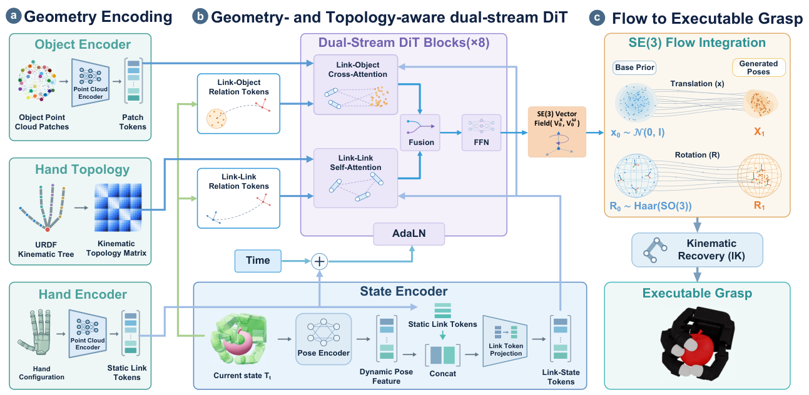
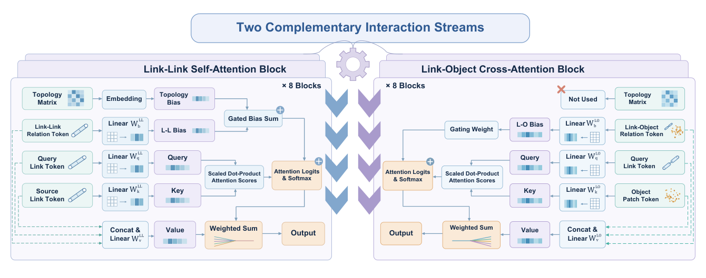
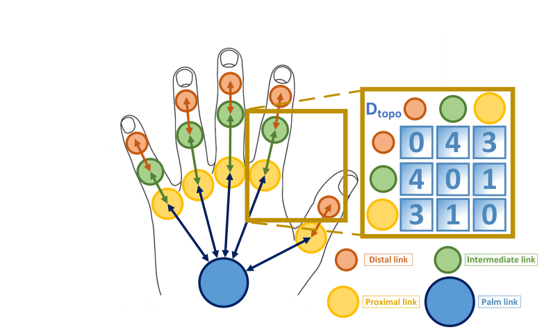
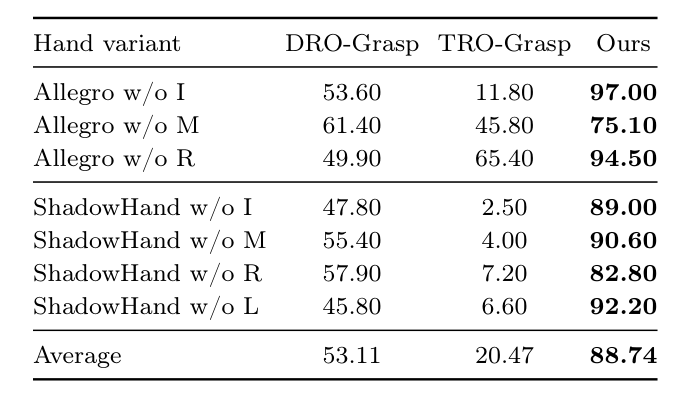
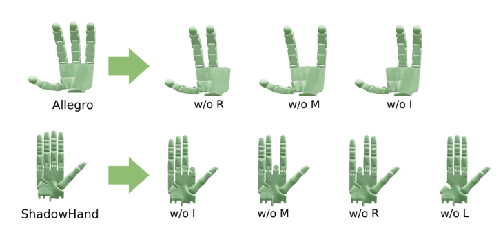

# DexGraspFlow：用拓撲感知的 SE(3) flow matching 生成跨手型靈巧抓取

| 速覽 | |
|---|---|
| **問題** | 不同靈巧手的關節數、link 幾何、運動學拓撲都不同，很難用一個模型生成抓取；只看空間關係會把「位置相近但屬於不同手指」的 link 搞混 |
| **核心想法** | 抓取 = 每個 link 的 SE(3) 位姿，用 flow matching 生成；URDF 運動學樹的最短路徑距離當成 link–link 注意力偏置 |
| **輸入 → 輸出** | 物體點雲 + 手的 URDF / 各 link 點雲 → 每個 link 的目標位姿 → IK → 手腕位姿 + 關節角 |
| **訓練** | CMapDataset 14,011 筆抓取（Barrett / Allegro / ShadowHand），平移與旋轉速度的 masked flow matching loss |
| **關鍵證據** | 7 種「拔掉一根手指」的未見手型 zero-shot：88.74% vs DRO-Grasp 53.11%、TRO-Grasp 20.47%（Table 2） |

## 0. 問題：它要解決什麼？之前的方法缺了什麼？

### 任務設定

**跨本體靈巧抓取生成（cross-embodiment dexterous grasp generation）**：給定物體點雲 $P^O \in \mathbb{R}^{N\times 3}$ 和一隻手（URDF + 每個 link 的局部點雲），生成穩定的抓取。同一個模型要同時服務三指的 Barrett、四指的 Allegro、五指的 ShadowHand，甚至訓練時沒看過的手型。

評估方式沿用 DRO-Grasp / TRO-Grasp 的協定（§4.1）：每個「物體–手」組合生成 100 個候選，在 Isaac Gym 中依序沿 $\pm x, \pm y, \pm z$ 施加外力（每個方向 1 秒，大小為每公斤物體質量 0.5 N），物體位移不超過 2 cm 才算成功。另外還測 zero-shot 手型、手掌朝向控制與真機抓取。

### 之前方法的缺口

| 先前方法 / 路線 | 怎麼做 | 缺了什麼 |
|---|---|---|
| 優化式：DFC、DexGraspNet | 每個抓取都做迭代搜尋 | 太慢，DFC 每個抓取超過 1800 秒（Table 1） |
| 關節空間表示：FFHNet、UniDexGrasp | 直接預測手腕位姿 + 關節角 | 各手的關節維度與語意不同，無法跨手共享 |
| 手無關的中間表示：GenDexGrasp（接觸圖）、DRO-Grasp（機器人–物體點對距離） | 先預測接觸 / 距離，再優化回關節 | 需要額外配對或重建步驟；DRO-Grasp 的密集兩兩距離吃記憶體，hand encoder 還要另外預訓練（§2.1） |
| link 位姿圖擴散：TRO-Grasp | 在 Lie algebra 座標上對 link 位姿做 graph diffusion，邊是相對空間變換 | **只看空間關係、忽略運動學拓撲**：空間上相鄰的 link 可能屬於不同手指分支；多層圖網路反覆評估，取樣成本累積 |
| 運動學樹 MPNN：GraspGraphNet | 沿運動學樹做 message passing | 遠端 link 之間要經過多次 hop 才能交換資訊 |

另外，實際部署需要**控制抓取的接近方向**（手掌朝向），而大部分方法只做無條件生成。

這四個缺口分別對應本篇的四個設計：link 級位姿表示（不需共享關節）、拓撲距離偏置（補上運動學結構）、flow matching（少步數、快）、切空間速度修正（免重訓的方向控制）。

## 1. 核心想法

**把抓取拆成各 link 的 SE(3) 位姿用 flow matching 生成，並以運動學樹距離作注意力偏置。**

- **link 位姿是所有手共通的語言**：不管幾根手指、幾個關節，手都只是一組剛體位姿。模型只生成 link 位姿，最後再用 IK 轉回各手自己的關節角，所以不需要共享關節參數化。
- **空間距離 ≠ 運動學關係**：拇指指尖和食指指尖可能靠得很近，但在運動學樹上距離很遠、幾乎獨立運動。把最短路徑距離加進注意力，網路就知道「哪些 link 在同一根手指上」。拔掉一根手指時，只要重算距離矩陣，表示法完全不變，因此能 zero-shot。
- **旋轉直接在 SO(3) 上沿測地線（geodesic）走**：旋轉速度在切空間裡，推論時可以直接加一個「把手掌轉向目標」的修正速度，不必重新訓練。
- flow matching 的直線 / 測地線路徑讓 **10 步 Euler** 就夠用，比 diffusion baseline 快約一半。

自我檢驗：只拿掉拓撲偏置（保留幾何偏置），ShadowHand 的成功率從 95.50% 掉到 82.10%（Table 4）。

## 2. 資料流

*圖：DexGraspFlow 總覽。(a) 物體與手的幾何編碼，運動學樹轉成拓撲距離矩陣；(b) 雙流 DiT 預測 SE(3) 速度場；(c) 從先驗分布積分出 link 位姿，再用 IK 轉成可執行抓取（論文 Figure 1）*

- **輸入**：
  - 物體點雲：每次從 65,536 個預先取樣的表面點中抽 $N=512$ 點，平移到物體中心 $c^O$、除以最大半邊長 $s^O$（物體座標系正規化）。
  - 手：URDF（運動學樹）+ 每個 link mesh 上用 FPS 取的局部點雲；所有手 padding 到 $L_{max}=26$ 個 link，用 validity mask $m_i$ 標記真實 link。
  - 推論初始狀態 $T_0$：平移 $\sim \mathcal{N}(0, \tau_x^2 I)$；旋轉以「隨機手型經 FK 得到的朝向」為中心做擾動，$\tau_x=\tau_R=0.2$（Eq. 8）。
- **輸出**：每個有效 link 的位姿 $(x_i, R_i) \in \mathbb{R}^3 \times SO(3)$，再經 IK 得到手腕位姿 $T_w$ 與手指關節角 $q$（維度依手而定）。

| # | 模組 | 輸入 → 輸出 | 作用 | 訓練狀態 |
|---|---|---|---|---|
| 1 | Object encoder（FPS + kNN 分 patch，共用點雲編碼器） | 512 點 → 25 個 patch token（64 維幾何特徵 + 中心、相對半徑、半徑、物體尺度） | 物體局部幾何 | 訓練 |
| 2 | Hand encoder（共用 residual 點雲編碼器 + MLP） | 每個 link 的點雲、局部中心 / 半徑、參考手型下相對手掌的位姿 → 128 維 static link token | link 形狀與它在手上的位置 | 訓練 |
| 3 | 拓撲距離矩陣 $D^{topo}$ | URDF → 物理 link 無向圖 → 兩兩最短路徑距離（clip 到 15） | 運動學結構，每隻手離線算一次 | 矩陣固定；每層的 embedding 可學 |
| 4 | State encoder | 當前位姿 $(x_{t,i}, \text{Rot6D}(R_{t,i}))$ → 64 維 dynamic feature，與 static token 串接投影 → 384 維 link-state token | 讓 token 知道 link「現在在哪」 | 訓練 |
| 5 | Relation tokens | 當前位姿 → LL：link 間相對位姿（9 維）；LO：link 到 patch 的位移 + link 朝向（9 維）→ 64 維 | 幾何關係，用來產生注意力偏置與 value | 訓練 |
| 6 | 雙流 DiT × 8（12 heads） | link-state tokens + object tokens + relation tokens + 拓撲偏置 + 條件 $c$ → 更新後的 link tokens | LL 自注意力（幾何 + 拓撲偏置）、LO 交叉注意力（幾何偏置），AdaLN 注入條件 | 訓練 |
| 7 | 線性預測頭 | link token → 6 維速度 $(\hat u^x_i, \hat u^\omega_i)$ | 平移 + 旋轉速度 | 訓練（權重零初始化） |
| 8 | SE(3) 積分 | 10 步 Euler：$x \leftarrow x + \Delta t\, \hat u^x$，$R \leftarrow R\,\mathrm{Exp}(\Delta t\, \hat u^\omega)$ | 從雜訊流到抓取位姿 | — |
| 9 | Pyroki batched IK | link 目標位姿 → 手腕位姿 + 關節角 | 轉成可執行配置（Eq. 22） | 優化，非學習 |

條件向量 $c$ = 時間的 Gaussian Fourier embedding（$\sigma=16$）經 MLP + 所有有效 static link token 的平均（代表整隻手的形態）（Eq. 11）。

**文字版骨架**：`物體點雲 → Object encoder → patch tokens ┃ URDF + link 點雲 → Hand encoder → static tokens ⊕ 當前位姿 → link-state tokens → 8 × 雙流 DiT（LL + 拓撲偏置 / LO）→ 6 維速度 → Euler 10 步 → link 位姿 → IK → 關節角`

### 雙流注意力

*圖：左邊是 link–link 自注意力（幾何偏置 + 拓撲偏置），右邊是 link–object 交叉注意力（只有幾何偏置，拓撲矩陣不使用）（論文 Figure 2）*

第 $a$ 個 head 的注意力 logits（Eq. 17）：

$$
\ell^{LL}_{ij,a} = \frac{(q^{LL}_{i,a})^\top k^{LL}_{j,a}}{\sqrt{d_a}} + \mu^{LL}_a(c)\, b^{LL}_{ij,a} + g^{topo}_a\, b^{topo}_{ij,a}
$$

$$
\ell^{LO}_{ij,a} = \frac{(q^{LO}_{i,a})^\top k^{LO}_{j,a}}{\sqrt{d_a}} + \mu^{LO}_a(c)\, b^{LO}_{ij,a}
$$

- $b^{s}_{ij}$：relation token 線性投影出的幾何偏置；$\mu^s_a(c)$ 是依條件 $c$ 變化的 gate。
- $b^{topo}_{ij} = E_{topo}(\mathrm{clip}(d^{topo}_{ij}, 0, 15))$：拓撲距離查表得到的每個 head 的偏置；$g^{topo}_a$ 是可學的 gate。
- value 不是只看來源 token，而是 $v_{ij} = W_V\,\mathrm{concat}(\bar h_i, \bar h_j, s_{ij})$，也就是**每一對 (i, j) 都有自己的 value**（Eq. 16）。

*圖：每個 link 是圖上的一個頂點，兩個 link 的距離是運動學樹上的最短路徑長度；右邊是 3×3 的子矩陣示意（論文 Figure 3）*

### 訓練時 vs 推論時

- **訓練**：示範抓取的關節角經 FK 得到目標 $T_1$；$T_0$ 的平移 $\sim \mathcal{N}(0, I)$、旋轉在 SO(3) 上均勻（Haar）取樣；隨機取 $t$，網路只看 $T_t$ 預測一次速度。
- **推論**：$T_0$ 改用溫度 0.2 的縮小分布，旋轉以隨機手型的 FK 結果為中心；積分 10 步；可選擇加手掌朝向導引；最後跑 IK。

### 推論時的手掌朝向導引（免重訓）

設手掌 link 為 $p$，目標朝向為 $R^c_p$。每個積分步都重算一次修正（Eq. 19–20）：

$$
\omega^c_t = \mathrm{Log}\!\left(R^c_p R_{t,p}^\top\right), \qquad
\tilde u^\omega_i = \hat u^\omega_i + m_i\, R_{t,i}^\top \big(s(t)\,\lambda_c\,\omega^c_t\big), \qquad
s(t) = s_0 \sin(\pi t / 2)
$$

- $\omega^c_t$ 是手掌目前朝向與目標之間的測地殘差，也就是能量 $\tfrac12\lVert\omega^c_t\rVert^2$ 的下降方向。
- 修正量廣播給所有 link（轉到各 link 的局部座標），只改旋轉速度、不改平移速度；$s(t)$ 讓導引越後期越強。預設 $s_0=1.0$、$\lambda_c=20$。
- 初始化時也會先把隨機手型的手掌轉到目標朝向，再做擾動。

### 白紙檢驗

畫架構圖時一定要畫對的點：

1. 生成的是**每個 link 的 SE(3) 位姿**，不是關節角；關節角最後才由 IK 得到。
2. 拓撲距離偏置**只進 LL 自注意力**，不進 LO 交叉注意力。
3. 位姿進網路兩次：絕對位姿透過 link-state token，相對位姿透過 relation token；relation token 每次評估速度場重算一次，8 個 block 共用。
4. 時間與「整隻手的形態」（static token 平均）一起經 AdaLN 調制每個 block。
5. 旋轉更新是 $R\,\mathrm{Exp}(\Delta t\,\omega)$，一直留在 SO(3) 上，不是直接加在 6D 表示上。

## 3. 怎麼訓練

### 資料

| 階段 | 資料集 | 規模 | 說明 |
|---|---|---|---|
| 模擬主實驗 | CMapDataset（沿用 DRO-Grasp 的過濾版切分） | 14,011 筆抓取示範、48 個物體（ContactDB + YCB），Barrett / Allegro / ShadowHand | 另保留 10 個未見物體做測試；關節角經 FK 轉成物體座標系下的 link 位姿（§4.1） |
| 真機實驗 | Linker Hand L20Lite 抓取示範 | 13,566 筆 | 為真機手另外訓練一個模型；資料如何收集論文未說明（§4.6） |

資料增強：表面點重新取樣、link 級幾何擾動、token masking。

### Loss

參考路徑（Eq. 4）與目標速度（Eq. 5）：

$$
x_{t,i} = (1-t)\,x_{0,i} + t\,x_{1,i}, \qquad
R_{t,i} = R_{0,i}\,\mathrm{Exp}\!\big(t\,\mathrm{Log}(R_{0,i}^\top R_{1,i})\big)
$$

$$
u^x_i = x_{1,i} - x_{0,i}, \qquad u^\omega_i = \mathrm{Log}(R_{0,i}^\top R_{1,i})
$$

Masked flow matching loss（Eq. 7）：

$$
\mathcal{L}_{FM} = \frac{1}{\sum_{i=1}^{L_{max}} m_i} \sum_{i=1}^{L_{max}} m_i \Big( \lambda_x \lVert \hat u^x_i - u^x_i \rVert_2^2 + \lambda_\omega \lVert \hat u^\omega_i - u^\omega_i \rVert_2^2 \Big)
$$

- 符號說明：$t \sim U(0,1)$；$m_i$ 是 validity mask，padding 的 link 不算 loss；$\mathrm{Exp}/\mathrm{Log}$ 是 SO(3) 的指數 / 對數映射（以旋轉向量表示）；$\hat u_i$ 是網路在 $(T_t, t)$ 的預測；$\lambda_x = \lambda_\omega = 1.0$。
- 白話：對每個 link，學「從雜訊位姿出發，平移走直線、旋轉沿測地線，等速走到示範位姿」的速度。目標速度在整條路徑上是常數，所以推論時用很少步數就能走到終點。

### 訓練細節

- 凍結 / 訓練：所有模組一起訓練，論文沒有提到預訓練或凍結的部分。
- 模型設定：$d_h=384$、8 個 DiT block、12 heads、relation token 64 維；物體 25 個 patch、每個 patch 24 個鄰居；拓撲距離 clip 到 15。參數量論文未說明。
- 優化：400 epochs、AdamW、batch size 16、learning rate $5\times10^{-4}$、weight decay $10^{-4}$、cosine schedule（20 epochs warm-up）、gradient clipping 0.2、EMA 0.999。
- 推論：10 步 Euler、$\tau_x = \tau_R = 0.2$。
- 算力：訓練硬體論文未說明；延遲測試使用 RTX 5090。

## 4. 證據與位置

### 最關鍵的實驗

*圖：拔掉一根手指的未見手型上的 zero-shot 成功率（%）（論文 Table 2）*

*圖：原始手型與拔掉 I / M / R / L（食指 / 中指 / 無名指 / 小指）的變體（論文 Figure 6）*

- **出處**：Table 2，§4.3。
- **設定**：Allegro 拔掉食指 / 中指 / 無名指、ShadowHand 拔掉食指 / 中指 / 無名指 / 小指，共 7 種訓練時沒看過的手型。只重算 link 特徵、validity mask 與拓撲距離矩陣，不重新訓練、不微調。10 個未見物體 × 100 個候選，每個方法 7,000 次模擬。
- **關鍵數字**：平均成功率 **88.74%**，DRO-Grasp 53.11%、TRO-Grasp 20.47%；本篇最低的 Allegro w/o M 也有 75.10%，而 TRO-Grasp 在 ShadowHand w/o I 只有 2.50%。
- **為什麼最能支持主張**：論文的核心主張是「只有空間關係不夠，要加上運動學拓撲」。這個實驗改變的正好就是手的拓撲。TRO-Grasp 同樣用 link 位姿、只缺拓撲資訊，換了手型就幾乎全面崩潰；本篇只換一張距離矩陣就維持高成功率。
- **Ablation**（Table 4，完整手型、無條件生成，成功率 %）：

  | 偏置設定 | Barrett | Allegro | ShadowHand | 平均 |
  |---|---|---|---|---|
  | 無偏置 | 86.10 | 98.30 | 75.50 | 86.63 |
  | 只有幾何偏置 | 87.50 | 99.50 | 82.10 | 89.70 |
  | 只有拓撲偏置 | 88.70 | 99.50 | 90.00 | 92.73 |
  | 幾何 + 拓撲 | 92.10 | 98.40 | 95.50 | 95.33 |

  拓撲偏置在結構最複雜的 ShadowHand 上效果最明顯（75.50 → 90.00）。

**其他實驗重點**：

| 實驗 | 結果 | 出處 |
|---|---|---|
| 主實驗（30 個物體–手組合） | 平均成功率 95.33%，TRO-Grasp 94.60%、DRO-Grasp 86.47%；單一抓取延遲 0.132 s（含 IK），TRO-Grasp 0.257 s，約快 49% | Table 1 |
| 手掌朝向控制（6 個方向） | 成功率 86.69% vs TRO-Grasp 73.75%；最終朝向誤差 13.92° vs 38.38° | Table 3 |
| 積分步數 | 1 步 62.47%、5 步 94.70%、10 步 95.33%（batch 100 下每個抓取 0.0257 s） | Table 5 |
| 導引強度 $\lambda_c$ | $\lambda_c$ 從 5 增加到 30：朝向誤差 22.135° → 12.225°，但成功率 89.08% → 83.50% | Table 6 |
| 真機（Linker Hand L20Lite） | 10 個未見物體共 100 次，成功 91 次；失敗主要來自光滑金屬表面打滑（罐子 7/10） | Table 7 |

### 在脈絡中的位置

- **改良了誰**：
  - **TRO-Grasp**（Fei et al., ICRA 2026）：最直接的前作，同樣用物體座標系下的 link 位姿、不需共享關節。本篇把 Lie algebra 上的 graph diffusion 換成 SE(3) flow matching（10 步），並把「只有空間變換的全連接邊」換成「幾何偏置 + 運動學樹距離偏置」的雙流注意力。
  - **DRO-Grasp**（Wei et al., ICRA 2025）：沿用它的資料切分與評估協定；去掉「預測點對距離 → 重建位姿」的中間步驟，直接生成 link 位姿。
  - **GraspGraphNet**（Lee et al., 2026，arXiv 2607.11031）：同樣利用運動學樹，但它用 MPNN 逐 hop 傳遞；本篇用全連接自注意力加距離偏置，一層就能讓遠端 link 互動。
  - 方法基礎：Flow Matching（Lipman et al., ICLR 2023）、Flow Matching on General Geometries（Chen & Lipman, ICLR 2024，SO(3) 上的測地路徑）、DiT（Peebles & Xie, ICCV 2023）、flow matching 導引（Feng et al., 2025）、Pyroki IK（Kim et al., IROS 2025）。
- **被誰取代 / 延伸**：論文 2026-10-18 才上 arXiv，2026-11 搜尋時尚未找到延伸或超越它的工作。同時期也有用 flow 生成靈巧抓取的 EquiDexFlow（arXiv 2606.12728，從標題看主打接觸與 SE(3) 等變性），本篇沒有和它比較。

**脈絡鏈**：GenDexGrasp (2023) → DRO-Grasp (2025) → TRO-Grasp (2026) → **DexGraspFlow** (2026)

## 5. 限制與疑問

- **作者承認的限制**（§5.2）：
  - 對形態和訓練手型差很多的全新手型，泛化仍有困難；zero-shot 只測了「拔掉手指」這種變化。
  - flow 生成的 SE(3) link 位姿沒有顯式限制關節極限和碰撞，物理可行性完全交給後面的 IK。
  - 未來方向：把可微的運動學與穿透約束放進 flow 積分、增加訓練手型的多樣性、加入接觸與任務條件。

> 解讀：各 link 的位姿是分開預測的，彼此不保證滿足剛體鏈的約束（例如 link 長度），要靠 IK「投影」回可行解，所以生成結果和最後執行的抓取可能有落差。Table 3 的朝向誤差是用 IK 之後的 FK 算的，這點比較公平。

> 解讀：Table 1 的成功率優勢其實很小（平均 +0.73 個百分點，Barrett 和 ShadowHand 還略低於 TRO-Grasp）。這篇真正的賣點是速度、zero-shot 手型泛化與方向控制。

> 解讀：Table 2 的巨大差距是整個系統的比較；Table 4 的 ablation 只在完整手型上做。缺少「拿掉拓撲偏置之後再測拔手指」的實驗，這才是最直接驗證核心主張的設定。

> 解讀：真機實驗是用 Linker Hand 的資料另外訓練一個模型，驗證的是「生成結果可以執行」，不是跨本體 zero-shot；抬起前還對手指屈曲關節加了一個固定的閉合 offset。

> 解讀：可以接著做的方向：(1) LEAP Hand 和 Allegro 同樣是四指 16 自由度，拿它測 zero-shot（沒看過、但拓撲相近）很適合檢驗這個表示法；(2) 手掌朝向導引是免訓練的條件，同樣的切空間修正可以推廣到 grasp taxonomy（例如 power vs precision grasp）的導引；(3) 接上 VLA，讓語言決定接近方向或抓取類型，DexGraspFlow 當作底層抓取生成器。

## 參考

- 論文：https://arxiv.org/abs/2610.26962
- 專案頁：https://zhoubin818.github.io/DexGraspFlow/
- 程式碼：論文未提供連結
- 相關論文：
  - TRO-Grasp — Fei et al., *T(R,O) Grasp: Efficient Graph Diffusion of Robot-Object Spatial Transformation for Cross-Embodiment Dexterous Grasping*, ICRA 2026
  - DRO-Grasp — Wei et al., *D(R,O) Grasp: A Unified Representation of Robot and Object Interaction for Cross-Embodiment Dexterous Grasping*, ICRA 2025
  - GraspGraphNet — Lee et al., *Graph-Structured Multi-Embodiment Dexterous Grasp Generation*, arXiv 2607.11031, 2026
  - GenDexGrasp — Li et al., *Generalizable Dexterous Grasping*, ICRA 2023
  - Chen & Lipman, *Flow Matching on General Geometries*, ICLR 2024
  - EquiDexFlow — arXiv 2606.12728, 2026（同期工作）
